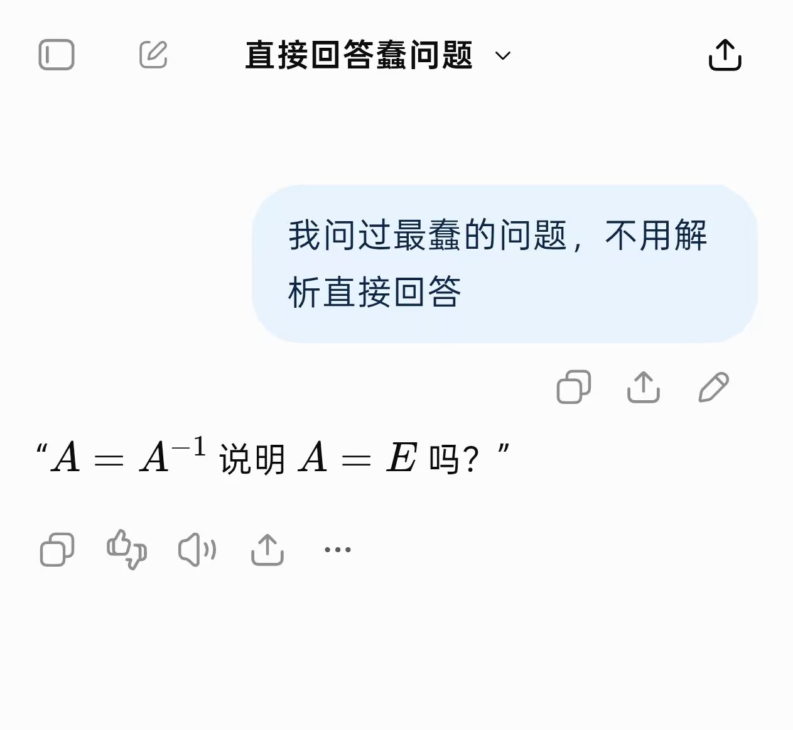

---
categories:
- Mathematics
# - Programming
# - Phase Field
# - Others
tags:
- Linear Algebra
- Group Theory
- Algebra 
- Abstract Algebra
- Note
title: 矩阵、乘法与单位元
description: 线性代数笔记-番外篇
date: 2026-11-11T19:55:20+08:00
image: /images/Eyjafjalla.jpg
imageObjectPosition: center 20%
math: true
hidden: false
comments: true
---

*方阵 $A$ 满足 $A=A^{-1}$ 能说明 $A=I$ 吗？好像不能……WHY？*

## 神奇的问题与错误的答案

某天，美丽群友[ClovertaTheTrilobita](https://cloverta.top/)给我展示了他和 AI 的聊天截图：

{width="55%"}

我当时看完，很快啊！给出如下回答：

> 从矩阵代数的角度，这个是成立的，因为单位元唯一，但是不显然，需要证明

美丽群友大为不结口牙！随后随手啊，真的是随手，抛出了一个反例：

$$
A = (-1)
$$

我：

毁了，全毁了。那一瞬间我想到了$+$，想到了装逼犯，想到了小学时候被老师讲了无数遍的 $x^2=1$ 所以 $x = \plusmn 1$…… 

{width="25%"}

犯了这种错误，得向全国人民谢罪吧…… 唉，所以这次的博客其实就是讲一下这么个幽默小故事。没别的了，散了散了~

但是我说婷婷！为什么，为什么乘法就不可以，为什么加法就可以；为什么 *正整数乘法* 就有这个性质，而 *整数乘法* 就没有；为什么我第一时间想到的是所谓的单位元唯一性；矩阵乘法究竟特殊在哪……

## 矩阵与乘法

在讨论这个问题之前，我们还是把要解决的问题说明白：

> [!QUESTION]
> 设有 $n$ 阶方阵 $A$ 满足 $A = A^{-1}$，其中 $A^{-1}$ 为 $A$ 的乘法逆元，满足 $A^2 = A A = I$，其中 $I$ 为 $n$ 阶单位阵。求问 $A$ 有什么性质，以及 $A$ 在什么情况下满足 $A = I$？

这里采用 $I$ 而不是 $E$ 完全出于作者的个人喜好（$I$代表 Identity 单位元）。也许您对方阵、矩阵乘法、矩阵逆、单位矩阵等概念已经比较了解了，但既然我们要研究的是这么一个很……初级的问题，我们还是多聊几句这些定义吧。

### 矩阵乘法：年轻人的第一款非交换乘法

谁不想拿一本国产线性代数教材急头白脸翻到第二章然后把矩阵乘法定义背的滚瓜烂熟呢？我的天呐这太难了。在第一章行列式的洗礼之后，我想一个小小的矩阵乘法定义没什么不好背诵的，毕竟，写成分量形式之后规则很清晰：

> [!THM]矩阵乘法
> 设有 $m$ 行 $n$ 列矩阵 $A$ 与 $n$ 行 $p$ 列矩阵 B，则矩阵乘法 $AB = C$ 为 $m$ 行 $p$ 列矩阵，其矩阵元定义为：
>
> $$c_{ij} = \sum_k^n a_{ik}b_{kj}$$

从这个定义的自由程度来看，我们很早就会意识到矩阵乘法不是对任意两个矩阵都能定义的，必须前一个矩阵的列数等于后一个矩阵的行数，从定义上天然说明了矩阵乘法不满足交换律。然而对方阵，即行数等于列数的矩阵来说，矩阵乘法是满足交换律的吗？简单的反例告诉我们不是的，矩阵乘法一般不满足交换律。比如

$$
A = \begin{pmatrix}
    1 & 0 \\
    0 & 0
\end{pmatrix}\;\;
B = \begin{pmatrix}
    0 & 0 \\
    1 & 0
\end{pmatrix}
$$

对这两个矩阵而言，$AB = O$ 而 $BA = B$，其中 $O$ 是每个位置都是 $0$ 的矩阵，又称零矩阵。以上的例子是笔者瞎写的，这样的例子随手都能举出很多来。然而，这样的非交换性的源头是什么呢？只是这个不知道怎么来的乘法定义吗？

要解决这个问题，我们得先了解矩阵在线性代数中的位置：线性映射的表示。

### 矩阵与线性映射

如果您看过我的[线性代数笔记II](/zh/posts/math_note/linear_algebra/la_2/)，那您应该已经知道了：矩阵其实就是线性映射在定义域与陪域的基向量下的表示。具体地说，我们给定义域与陪域两个线性空间都确定好基，此时两个空间中的所有向量都可以有一个数表表示（也就是我们常说的列向量）。那么线性映射要表示成为矩阵，只需要确定定义域中每个 *基向量* 在线性映射下映射到了陪域中之后，在陪域中基向量的表示。

比如一个矩阵：

$$
A = \begin{pmatrix}
    1 & 3 & 5 \\
    0 & 7 & 4 
\end{pmatrix}
$$

它代表的含义是什么呢？首先它的定义域是三维线性空间，我们取其中的一个向量 $\vect{v} = {(1,2,3)}\t$，那么它在映射到陪域中后，在第一个基向量上的分量是 $1+2\times 3+3\times 5 = 22$，而在第二个基向量上的分量则是 $0+2\times 7+3\times 4 = 26$。我们换一个向量，它的组合方式是一样的。

更一般地，我们考虑三维空间的三个基向量 $\vect{e}_1 = (1,0,0)\t,\vect{e}_2 = (0,1,0)\t,\vect{e}_3 = (0,0,1)\t$，它们在被映射后得到的向量在陪域的基向量下表示就是 $A(\vect{e}_1) = (1,0)\t, A(\vect{e}_2) = (3,7)\t, A(\vect{e}_3) = (5,4)\t$。那么由于线性映射的特点，我们在原空间中做的任何线性组合都会通过线性映射保留到陪域上，比如例子里的 $\vect{v}$，我们可以在陪域上对 $A(\vect{e}_1), A(\vect{e}_2), A(\vect{e}_3)$ 进行同样的组合：$A(\vect{e}_1)+2A(\vect{e}_2)+3A(\vect{e}_3) = A(\vect{v}) = (22,26)\t$。

所以，其实矩阵就是线性映射（在我们认为所有线性空间已经有固定好的基的时候）！但这和矩阵乘法之间有什么关系呢？

### 矩阵乘法与映射复合

考虑到矩阵就是线性映射，最自然的（也是最早的）考虑便是让映射复合体现在矩阵上成为矩阵乘法。实际上如果我们将上面分析矩阵与线性映射的方法应用到映射复合上，那么矩阵乘法的定义就很明显了。这恰好也解释了为什么矩阵乘法是不交换的：映射的复合本就是不交换的。

## 群与乘法

聊到了乘法，加法和线性代数，就很难不先聊一个抽象代数中很重要的概念：**群**。

### 法国小学生的加法课

虽然这个故事很老套，但这一切真可以从法国小学生的数学课开始。在布尔巴基学派的影响下，有这样一个笑话：

> 路人问小学生：2+3是多少呀？小学生答：不知道
>
> 旋即路人问：那3+2是多少呢？小学生答：不知道
>
> 路人：啊？你们学了什么？你知道什么？小学生：我知道 2+3 等于 3+2，因为整数加法是阿贝尔群。

其实法国小学生并不这么学（至少现在不会），但整数加法真的是阿贝尔群。那么这和上面的问题有什么联系呢？因为矩阵的乘法不形成阿贝尔群。

### 阿贝尔群、乘法与加法

